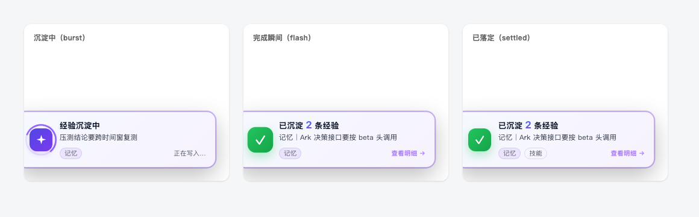
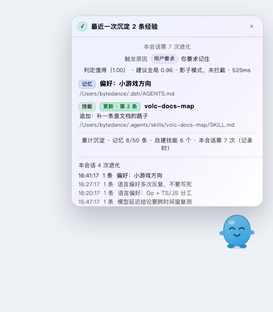
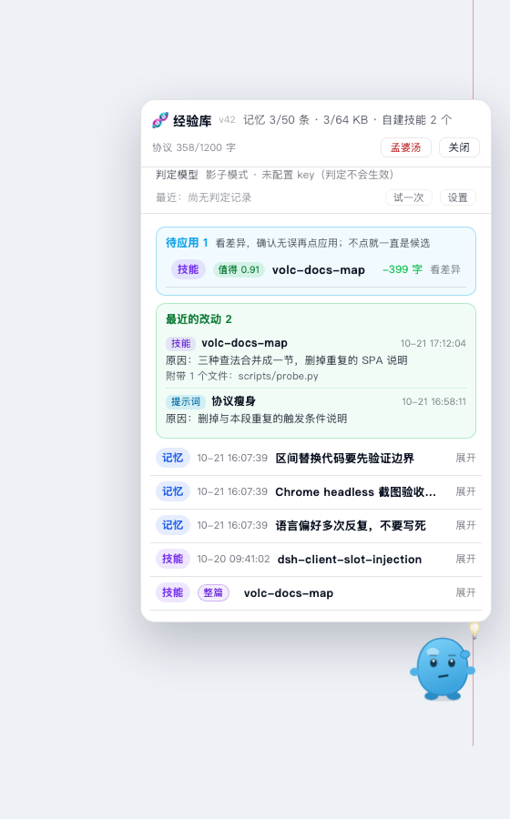
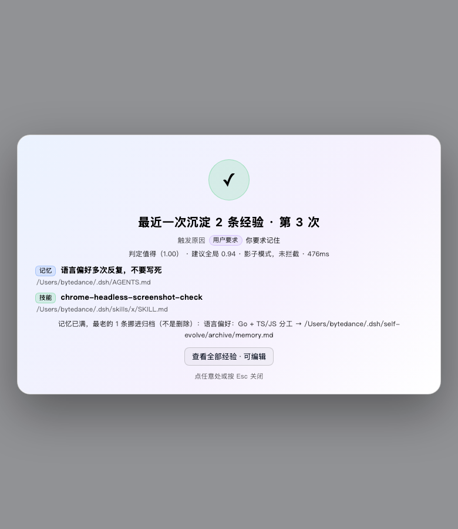

# 自我进化 🧬 (self-evolve)

DeepSeek Harness 的「经验自沉淀」插件：**等一次任务完整结束后**，它才做一次复盘，把结论真正写进磁盘——全局记忆和可复用的技能；落盘时页面上会播一次进化动画。

## 效果一览

**桌宠与它的几种状态**：写入中、沉淀成功、归档、思考，以及右上角的累计角标。


**右下角小卡**：同一会话第 2 次进化起，只以小卡形式自动出现，不打断阅读。


**dock 卡片的三个阶段**：沉淀中（burst）→ 完成瞬间（flash）→ 已落定（settled）。



**台账**：最近一次沉淀的触发原因、判定值、写入落点与本会话历史。



**经验库**：点桌宠进入——记忆 / 技能列表、待应用的技能提案（看 diff 后应用）、就地编辑与删除、孟婆汤。



**整屏卡片**：点开小卡后的完整沉淀报告，可一键查看全部经验。



## 安装

三个步骤，详见 [INSTALL.md](INSTALL.md)：

1. 把本目录放到一个固定位置（如 `~/plugins/self-evolve/`）；
2. 在 profile 的 `package.json` 里把 `@local/self-evolve` 以 `link:` 方式加进 `dependencies` 和 `dsh.profile.bundles`；
3. `pnpm install`（或手动建软链）后重启 DSH。

## 日常用法

装好后**不需要你做任何事**：

- 平时它完全隐身，只在任务结束时于右下角弹一次小卡；
- **点桌宠**打开经验库：看记忆 / 技能、应用或丢弃技能提案、就地编辑删除、用「孟婆汤」批量清空；
- **对模型说「记住……」**会直接触发一次沉淀（不必等失败或长链路）；
- 进阶：给判定模型配一个 key（不配也能用，判定降级为直接写入），详见下文 [配置](#配置)；
- 数据全部落在本地：项目记忆在工作区 `AGENTS.md`、全局记忆在 `$DSH_HOME/AGENTS.md`、技能在 `~/.agents/skills/`，落点明细见 [INSTALL.md](INSTALL.md)。

模型侧提供三个工具（`self_evolve_record` / `self_evolve_propose` / `self_evolve_status`），见下文 [两个工具](#两个工具)。

## 关键设计：任务结束后才进化，绝不中途打断

早期版本在跑到第 15 步时就插话「先停下来总结」，这是错的：**一个正常的长任务本来就会走十几二十步**，中途打断只会破坏正在进行的工作，而且此时模型还没看到结果，总结的也只能是半成品。

现在计数只做累计。**触发信号不产生任何消息**：每步 `agent/pre-step` 评估一次，条件满足就把该 agent 标成「本轮已就绪」，于是 `ctx.systemPrompt.context()` 的动态段落在下一次模型请求里出现——只有模型能看到，对话流里一个字都不会多出来。模型在给出**最终回答之前**顺手写完经验，本轮正常结束。

> 早先的实现用 `agent.steer()` 在 turn 结束时追加一步专门复盘。副作用很严重：那一步的回复成了「本轮最后一条助手消息」，真正的结论被挤进折叠的「已调用工具」分组，用户不点展开就只看到一句「报告已在上面给出」——等于把答案藏起来了。任何「结束时追加一步」的机制都有这个风险，所以触发改成了途中注入。

## 它解决的问题

1. **越走越远**：一个任务连了十几二十次工具调用，方向早就偏了，但每一步看起来都「合理」。
2. **对着报错硬撞**：同一条 `bash` 命令换个写法再试，连续失败，却始终没换思路。
3. **流程白白流失**：一条多步骤流程好不容易走通了，下次同类任务又从头摸一遍。

这三种都不是「再试一次」能解决的，需要的是任务结束后的一次复盘。本插件把复盘变成**可触发的机制**，而不是靠模型自觉。

## 触发条件

**核心原则：长度不是价值。** 一个正常的开发任务轻松就能跑过 15 步，如果把它当成「值得沉淀」，结果就是每轮都来一次复盘、记忆体里堆满噪声。所以「跑了多少步」默认**不参与**触发判断。

只有三种情形值得复盘，都在**任务结束时**评估，合并成一次：

| 信号 | 默认阈值 | 说明 |
| --- | --- | --- |
| 用户明确要求记住 | 命中即触发 | 说「记住/以后都/我习惯/我偏好…」这类祈使句，不必等失败或长链路 |
| 确实出过问题 | 任意工具失败 2 次 | 不只 shell——`edit` 因文件变更失败同样值得复盘 |
| 走通了复杂流程 | 25 步 **且** 4 种工具 | 只有真正的多工具长链路才算，避免把日常开发误判成新工作流 |

- **用户要求记住**：在 `agent/pre-step` 里解析**用户这一条消息**，命中就本轮就绪——必须在这一步注入，因为「记住我喜欢 X」往往只有一两步、没有任何后续步骤可以等提示。命中的是祈使句（记住 / 记一下 / 以后都 / 我习惯 / 我偏好 / `remember that` / `from now on`），**不**命中原话里的回忆问句（「你还记得…吗」）。偏好类会直接指向 `scope: "global"`，仓库约定仍留在项目级。

- **失败判定**：结果 `isError`、出现 `[exit code: N]`（N≠0）、`[timed out after ...]`、`[killed by signal: ...]` 都算失败。
- **shell 连续失败**：`bash` / `shell` 连续失败峰值达 3 次也会触发（更严格的「反复撞墙」信号）。
- **链路计数**：用户发新消息即清零，所以阈值衡量的是「这一轮」。
- **不重复**：同一个 `turn` 无论复盘后再走多少步，都只触发一次（用 turn 号做幂等键）。
- **想恢复旧行为**：把 `triggerOnLengthOnly` 设为 `true`，则满 `chainSteps` 步也会触发。

## 触发之后发生什么

协议正文通过 `ctx.systemPrompt.section()` 写进系统提示；触发就绪通过 `ctx.systemPrompt.context()` 写进**按步刷新**的动态上下文。两者都只面向模型，用户在界面上永远看不到，也**不会多出一条消息**。

协议的基调是 **默认什么都不写**：

1. 大多数长任务没有可复用经验，长度不等于价值；
2. 只有产出了「会让未来的你做得不一样」的经验才落盘；
3. **最多调用一次** `self_evolve_record`，挑最有价值的那条，其余全部放弃；
4. 明确列出**不要记录**的内容：这个任务做成了什么、报错原文、记忆里已有道理的另一种说法；
5. 没有合格的就直接结束本轮，不向用户解释协议或标记。

「一次最多一条」不只写在协议里，工具侧也硬性限制（`maxRecordsPerTurn`，默认 1）：超出的调用会直接返回 `skipped`，不落盘。

**中途暂停不触发**：`ask_user_question`、`exit_plan_mode` 之后的 turn 结束是任务中途停下来等用户，不是任务完成——插件观察到这两类工具调用后跳过触发，等任务真正走完的 turn 再进化。否则复盘提示会插在任务结果前面（实测踩过）。

## 进化动画

**只有一种自动动画：右下角小卡。** 早先是「第 1 次整屏、第 2 次起小卡」，两个问题：整屏那一次恰好会盖住正在流式输出的回答；而且用户根本不知道自己会看到两种形态。现在整屏只作为**点开**的结果存在。

### 桌宠（自动出现的唯一形态）

气泡里的「第 N 次」是**本会话第几次进化**，不是记忆条数；条数单独写成「X 条｜记忆｜标题」。
早先把进化序号直接印成「记住啦 · 8 条」，会被读成「记忆里一共 8 条」。

一只蓝绿色的小史莱姆，住在右下角。它不是装饰：**它在替你把经验写进记忆**。

| 状态 | 它做什么 |
| --- | --- |
| 沉淀中 | 低头写字：眼睛眯成两条线、嘴抿成小圆、右手拿铅笔一直划、身后一圈进度弧 |
| 完成 | 高兴地跳一下：眼睛变 ^ ^、张大嘴笑、蹦三颗星星、气泡描边变绿 |
| 落定 | 恢复平静，气泡里报「记住啦 · N 条」和最新一条的标题 |
| 待机 | **常驻**：气泡 7 秒后自己收起来，桌宠不走；右上角挂一枚累计条数徽标 |
| 忘掉 | 删一条 / 倒孟婆汤时：眼睛变成 `× ×`、嘴角向下、头顶冒一团灰烟，气泡说「忘掉啦 · N 条」 |
| 交互 | **拖得动**（位置存本地）；点一下展开整屏台账；悬停出现 × 可以藏起来 |
| 打开经验库 | 抬手敲太阳穴、头顶亮一颗灯泡（`mood: 'think'`）——「我在翻记忆」 |
| 藏起来之后 | 原地留一颗 🧬 小按钮，点它就能叫回来（**不写 localStorage**：刷新必回来） |

气泡说的话比报表口吻亲切：`记一下…` / `记住啦 · 2 条`。

### 两张卡片，都是桌宠的对话框

| 卡片 | 内容 | 位置 |
| --- | --- | --- |
| **台账** | 最近一次沉淀了什么、为什么触发、判定模型怎么说、本会话进化历史 | 桌宠头顶，**可拖**，Esc / × 关闭 |
| **经验库** | 全部条目，可就地编辑 / 删除 / 孟婆汤 | 同上，**可拖**，位置与台账共用 `self-evolve:panel-pos` |

两张卡都是「浮层里的一块」，不铺满、不压暗背景——聊天还在旁边。桌宠在旁边给出表情：
台账打开时是**笑**（`mood: 'smile'`，眼睛弯成两道弧），经验库打开时是**敲太阳穴**（`mood: 'think'`）。

### 整篇技能也要出现在经验库里

`kind: 'both'` 那种「写成一整篇文档」的技能没有 `- 日期 · 标题：正文` 行，早先列表按行扫，
于是**技能文件确实生成了、记忆里也有条目，经验库里却什么都看不到**。现在：没有行就整篇列一条，
带 `整篇` 标记、展开看全文，编辑/删除按钮隐藏（那种技能要改就改文件）。

### 经验库：桌宠头顶的一块卡片

经验库不再是整屏弹窗，而是**停在桌宠上方**的 384px 小卡（`position: fixed; right: 20; bottom: 216`），
聊天还能继续看，桌宠也还在旁边站着——点它就把卡片收起来。

| 之前 | 现在 |
| --- | --- |
| 整屏 + 背景模糊，像「进入了一个新页面」 | 右下角小卡，随时能回去看聊天 |
| 720px 居中 | 384px 贴边，改动在上下文里发生 |
| 位置写死 | **按住标题栏可以拖走**，位置记在 `self-evolve:panel-pos` |

拖动一律走 `trackPanelDrag`：

- **挂在 window 上**，不是元素上：按下时同时挂 `pointermove` 与 `mousemove`，松手/失焦一起摘掉。
  容器自己做了 `pointer capture` 时 pointer 系列会被吞，鼠标事件仍然通。
- **整张卡片都是把手**，不只标题栏——没人会去找那条 10px 高的标题栏。按钮/输入框/链接除外。
- 同一次拖拽只允许一个 owner（`pointerdown` 和 `mousedown` 会连着来）。
- 同时挂 **document 捕获阶段**监听：宿主只要在某层 `stopPropagation`，React 合成事件就到不了，
  表现是「按钮能点、卡就是拖不动」。捕获阶段先于任何元素处理函数。
- 拖不动的兜底：**双击标题栏**在四个角之间跳（`self-evolve:panel-pos` 同样会记住）。

### 卡片为什么不能透明

主题的 `--dsw-alias-bg-layer-1` 可能是半透明的（毛玻璃风），只拿它当底色，聊天内容会透上来。
所以卡片是两层：`--dsw-alias-bg-base` 打底（不透明）+ `bg-layer-1` 叠一层，合成后一定不透明，
颜色仍然跟着主题走。

> 为什么换成桌宠：卡片只能表达「有进度」，桌宠能表达**情绪**。同一件事，记忆点差一个数量级。整屏台账仍然保留，但只作为「点开」的结果。

### 进度环为什么用 SVG，而且不用渐变

早先的「转圈」是给 `div` 加 `border-top-color` 假装一段弧——圆角接缝处粗细必然不匀，小尺寸下看起来像被压扁的椭圆。现在统一用 `EvolveSpinner`：一个 `<svg>` 圆 + `stroke-dasharray`，配 `pathLength=100` 让弧长按百分比写，端点圆头。

两条规则是踩出来的：

1. **描边用实色，不用渐变。** 渐变是跟着元素一起旋转的，转起来像一块颜色在绕圈，视觉上很不安分；
2. **弧长会「呼吸」**（`stroke-dasharray` 在 8%→58% 之间伸缩 + 轻微追赶），这是加载的标准语汇，比一条固定弧干转更像在干活；半径大的环（整屏 200 px）用更短的弧（5%→26%），否则百分比一样、看起来像把扫帚。

> 踩过的坑：渐变 `id` 和 `url(#id)` 写不一致时，浏览器**不报错、什么都不画**——环看起来「消失」，会让人误判成尺寸问题。

另外，卡片底色**不要**用 `Canvas` / `color-mix()`：旧内核里这两个会让整条声明失效，卡片直接变全透明、文字压在对话上。统一走 `var(--dsw-alias-bg-layer-1, #ffffff)` + 十六进制兜底。

### 小卡（同一会话第 2 次起）

- **本轮还在跑就会出现，并且一路走到完成**：小卡不遮正文，所以不必等回答流完——「经验沉淀中」这一刻终于看得见了；工具一返回就**原地**接上「完成」（绿光扩散一次、转环停、图标弹成 ✓、620 ms 后落定），中间不断档、不重播（整屏仍要等本轮结束）；
- 位置固定在右下角（330 px，`zIndex 9998`），**不遮挡对话**，出现时从右侧滑入并带一次呼吸光晕；
- 写入中：左侧渐变亮条脉冲 + 图标外一圈进度弧 + 「正在写入…」（不再有扫光，卡片上「一块光在走」很容易读成错位）；
- 落定后：绿色 ✓、渐变数字（`已沉淀 2 条经验`）、最新一条的标题、3.0 s 后滑出；
- 点小卡升级为整屏台账（且不再自动收起）；Esc / 点空白仍可关闭。

> 小卡的三条设计约束：①「余光能看见」靠持续运动（光晕/转环/亮条脉冲），不靠尺寸；② 不动正文——没有全屏遮罩；③ 不重复说同一件事——第 2 次以后就只报「写了什么」。

### 累计进化数量（同一会话多次进化）

台账末尾会多一句 **「累计沉淀 · 记忆 N/上限 条 · 自建技能 M 个 · 本会话第 K 次」**，入口按钮上有一个小徽标显示 `K`：

- **`M` 只数本插件写的技能**：技能根目录里还有你原有的技能，按目录数会虚高（本机 39 个里只有 6 个是插件写的）。新技能写入时带一行 `<!-- self-evolve:skill -->`，老文件按正文里的托管标题兜底识别；
- `K` 由 Client 半从会话快照里数出来（每次成功的 `self_evolve_record` 留一个结果根）；
- 计数做了**单调保底**：长会话的快照可能只保留最近一段节点，直接数会偏小，而沉淀次数只增不减，所以按会话记住「见过的最大值」，切走再回来不会倒退；
- 刷新页面后从快照重新数；判断依据是「本会话」，不是全局 `K`（全局积累量在 `记忆 N 条 · 技能 M 个`）。

> 另一个相关行为：**老记录点开会直接进台账**，不重放旋转/闪光过场——重放会让人以为「又进化了一次」。

### 动画时机由 `running` 门控

模型现在是在给出**最终回答之前**调用记录工具的。如果一有记录就弹整屏，动画会盖在正在流式输出的答案上——正是「任务结果还没出来就弹进化」。所以状态桥读会话快照的 `running`：

| `running` | 表现 |
|---|---|
| `true`（本轮还在跑） | 什么都不显示，绝不遮挡答案 |
| `false` + 记录在写 | 整屏动画开始演（`waiting`） |
| `false` + 刚写完 | 演完落定，显示台账（`fresh`） |
| `false` + 老记录 | 只留入口按钮（`settled`） |

### 累计数字是实时的，不是记录里的快照

台账最后一行「累计沉淀 · 记忆 18/50 条 · 自建技能 6 个 · 本会话第 1 次」：

- **记忆 / 自建技能**：渲染时现取 `/api/self-evolve/lessons` 的 `stats`，跟着库里的真实存量走。
- 拿不到实时值（路由失败 / 老页面）才退回工具结果里的快照，并显式标注 **（记录时）**。

为什么必须这样：工具结果里的 `stats` 是**落盘那一刻**的快照，历史记录会一直带着当时的数字。早先的版本还把技能根目录总数当成自建数——于是老记录上永远显示「自建技能 38 个」，而真实的托管技能只有 6 个（目录里另外 33 个是用户自己的）。数字一旦写进记录就再也不会自愈，所以存量数字只能现取。

「自建技能」的口径：`SKILL.md` 里带 `<!-- self-evolve:skill -->` 或「经验教训（self-evolve 自动维护）」小节。目录里的其它技能属于用户，不参与计数。

### 语义去重：换个说法不再堆一条

只按标题/正文完全相同去重，会攒出「三条讲火山文档都返回 200」的条目。判定模型现在
额外回答 `merge_v1`：把已有标题摊给它，指认「这条只是在重说第 k 条」。命中就取代那一条
（原文进归档），而不是新增。索引越界一律当「没有重复」，fail-open。

### 优化任何技能（包括用户自己写的）+ 留下原因

`self_evolve_propose` 的目标从「只允许自建技能」放宽到**技能目录下的任何技能**：

- 用户要的就是「把我已有的技能不断优化」，提示词（`body`）和脚本（`files`）都要能改；
- 安全性不靠限制范围，靠流程：模型只能提交，落盘必须由人在经验库里点「应用」；
- 两条底线没变：自建技能必须保留归属标记；**用户自己的技能，改写里不许悄悄加标记**（那是接管）。

「为什么改」贯穿到底：

| 阶段 | 存哪 |
|---|---|
| 提交 | 提案记录 `reason` |
| 应用 | `history/<id>.json` 写入 `reason` / `files` / `at` |
| 之后 | `self-evolve/applied.json` 留 50 条，经验库顶部「最近的改动」逐条显示 `原因：…`、时间、附带文件 |

### 记忆判定看得见正文，也管「过期」

只给标题的判定抓不到「财报取数链路」和「联网搜索走豆包 CLI」是同一件事。现在交给
判定模型的是**每条已有条目的标题 + 正文前 160 字 + 所在档位**（最多 12 条），并问两个新问题：

| 问题 | 用途 |
|---|---|
| `relation_v1` | 这条是不是在更新已有某条 → 命中即取代（**跨档也可以**） |
| `stale_v1` | 这次写入让哪条旧条目的前提不再成立 → 单独归档，标记「前提已过期」 |

跨档命中时，旧条目会从**另一份文件**里被移除并归档，新条目落到更合适的那一档，
结果里回 `clearedElsewhere: [{path, title, reason}]`。

### 全局档放宽：偏好 + 本机环境事实

`ENV_FACT_OK`（本机 / key 在哪 / 装在哪个路径 / 只能用某条命令 / `.py` `.sh`）也算全局，
因为换个仓库依然成立；`PROJECT_LOCAL`（工作区路径、仓库名、localhost 端口）依旧强制项目级。

### 判定流程：两段式 + 置信度闸门（官方最佳实践）

按 System One 培训纪要的四条建议重构：

| 建议 | 落地 |
|---|---|
| question 短，正文挪进 state | criteria 只留 `[全局] 标题`，正文只在 `state.existing` 出现一次（200 字） |
| 阶段一要看得到「记过什么」 | `state.titles` 带**全量**已记标题（上限 60，带 `eN` 编号与档位）：截断会让「很久以前记过」的条目彻底隐形 |
| 正文只给相关的 | `state.existing` 放召回的前 12 条正文（200 字）；挑选靠编号 `eN`，选项本身极短 |
| 固定内容前置、动态内容末尾 | 请求体改成 `{model, questions, state}`；两段请求的 `worth_v1` 逐字节相同，第二段是第一段的前缀 → 命中 prefix cache |
| 多问题无上下文，逻辑树自己做 | `worth` 闸门 → 不值得直接返回（省掉整次请求）→ `scope` 定档 → `relation` 取代 → `stale` 过期 |
| 枚举用选择题 | 全部 `choice`；低置信的取代/过期不执行（`relationMinConfidence`，默认 0.5） |

实测：不值得的条目只发 1 段（约 400ms）；值得的发 2 段（700–1100ms）。
`stagedJudge: false` 可退回单次四问。

### 智能记忆：召回、自动整理、自动合并

「智能」不是多一个按钮，是这三件事都不用人管：

| 环节 | 行为 |
|---|---|
| **召回** | 判定模型不再看「前 12 条」，而是按相关性（二元组 + 稀有词）挑最可能的 12 条，再补最近 4 条 |
| **自动整理** | 每次沉淀后，若距上次整理超过 6 小时且条目 ≥ 6，后台巡检一次（`autoAudit`，失败不影响本轮） |
| **自动合并** | 巡检判为 `same`（同一件事）的对，自动留新的、旧的进归档（`autoMergeAudit`）；`update`/`complement` 不动，留给人在面板上点 |

标题行会显示 `整理 17:52 · 合并 1`，说明记忆最近被自动收拾过。

### 体检：管已经写进去的存量

写入时判断只管新条目。面板顶部「体检」会：

1. 本地粗筛候选对（中文二元组相似度，或共用 `web_search` 这类稀有词）；
2. 每对问判定模型一句 `same / update / complement / unrelated`；
3. 列出来，点「合并（留新的）」才落盘——旧条目进归档。

### 技能改写也要过决策模型

改记忆是「加一条」，改技能是「替换已有的东西」——写成更啰嗦的版本就是回归。所以
`kind='skill'` 的提案在提交前多问一次（`worth_v2`，同一个 System One 接口）：

| 结论 | 非影子模式 | 影子模式 |
|---|---|---|
| 值得（worth ≥ 阈值） | 入队 | 入队 |
| 不值得 | **拒绝提交**，提示「只是换措辞/格式」 | 入队，标「影子模式，未拦截」 |
| 超时 / 网络错（900ms） | fail-open，入队 | 同左 |

判定结论跟着提案走（`judgement`），提案卡上显示 `判定值得应用（0.91）· 412ms`。
没配 key 就完全不问模型，0 延迟。

### 技能提案可以带附属文件

`self_evolve_propose({ kind: 'skill', files: [{ path: 'scripts/fetch.py', content }] })`：

- 路径必须是技能目录内的相对路径（禁 `..`、禁绝对路径、禁反斜杠）；
- 单文件 120K 字、合计 300K 字上限；
- 正文点名的 `scripts/…` 必须在磁盘上或随提案提供（否则报断链）；
- 提案带的文件必须在正文里被提到（否则报「正文没有提到它」）；
- 应用时逐文件做冲突检测，任一文件在提案后被改过就整份拒绝；应用记录进 `history/<id>.json`。

### 不接管用户技能

`kind: 'skill'` 命中一份**没有归属标记**的 `SKILL.md` 时默认拒写，错误里说明用
`adopt: true` 才能显式接管。理由是 `appendSkillLesson` 会顺手补上标记——一旦写进去，
这份技能从此算插件的，统计/改写/列表全都当它自产。

### 归档与孤儿清理

- 归档主文件超过 `maxArchiveBytes`（默认 256 KB）→ 最老的小节轮转进 `archive/memory-YYYY-MM.md`；
- 被取代/淘汰的条目如果指向 `details/*.md`，而留下的人都不再引用它，文件挪进 `archive/details/`（不删）；
- 归档时间戳与记忆条目统一用本地秒级时间（以前是 UTC ISO）。

### 记录时间精确到秒

记忆条目的格式是 `- 2026-10-21 16:07:39 · 标题：正文`。以前只有日期，同一天里谁先谁后
看不出来，也对不上会话日志；现在写入与**更新**都盖秒级时间戳（本地时间）。老条目只有日期，
解析仍然兼容，不会因为格式升级而丢。

### 「优化了已有技能」必须能证明

技能有两种动作：`create`（新建 SKILL.md）与 `update`（往已有技能的经验小节里追加一条）。
只回一个 `kind: 'skill'` 时两者在界面上长得一模一样，用户无法核对，所以结果里带三样东西：

- `skillName`：改的是哪个技能；
- `previousEntries` / `entries`：改前几条、改后几条；
- `action`：`create` / `update` / `unchanged`（去重命中）。

界面对应显示 `技能 · 更新 · 第 2 条 volc-docs-map` + `追加：这次学到的那条`；桌宠气泡写
「更新技能 volc-docs-map · 第 2 条」，新建则写「新建技能 X」。字段必须写进输出 schema
（`additionalProperties: false` 会拒掉没声明的字段）。

### 同一个话题：更新，而不是追加

用户先说「喜欢 TS/JS」，又说「也喜欢 Java」，再说「不喜欢 Java」——如果按条追加，文件里会攒出三条互相矛盾的偏好。所以记忆写入有两条取代规则：

1. **标题相同** → 原地更新（老行为，把条目挪到末尾）；
2. **两边都是偏好类**（标题或正文含 偏好/喜欢/不喜欢/习惯/prefer…）**且话题词重合够多** → 新条取代旧条。话题词打分：共用的英文技术词（`ts/js`、`java`、`python`）算 2 分，共用的中文双字词算 1 分，达到 2 分才算同一件事——这样「配色偏好」不会吃掉「语言偏好」。

被取代的原文进归档（`$DSH_HOME/self-evolve/archive/memory.md`，标题「被新结论取代」），不在文件里静默消失。

## 记忆分两档：项目级（默认）与全局

一条经验该写进哪儿，是「价值 × 加载频率」的取舍：

| 档位 | 文件 | 谁加载 | 放什么 |
| --- | --- | --- | --- |
| **项目级（默认）** | `<工作区>/AGENTS.md` | 只有这个仓库的会话 | 本仓库的命令、路径、已知坑、流程约定 |
| **全局** | `$DSH_HOME/AGENTS.md` | **每个项目的每个会话** | **只放用户的长期偏好**（语言、格式、习惯、协作方式） |

模型通过 `self_evolve_record` 的 `scope` 参数选择（`project` 缺省 / `global`），判断规则写在参数描述里：**拿不准就写项目级**——全局写错是「每个请求都多背一段」，项目级写错只是「这个仓库多记一条」。

**这条规则在代码里兜底**（`GLOBAL_SCOPE_OK`）：落点算出来是 `global`、但标题/结论里没有任何「偏好 / 习惯 / 风格 / 回答方式」信号时，直接改判项目级，并在结果里带上 `scopeNote`。判定模型的 `scope` 建议同样过这一关——它很喜欢把「某个站点/接口怎么调」判成跨项目事实，实测置信度 0.85 也没挡住；一个文档站点的接口用法不该跟着每个项目走。

配置层 `scope` 决定这套机制是否生效：

- `auto`（默认）：两档并存，由模型逐条选择；
- `global` / `workspace`：锁死单档，模型传什么都不改变落点。

界面里每条记忆带 `全局` / `项目` 小标，头部显示分档数字 `记忆 6/50 条 · 全局 2 / 项目 4`，孟婆汤也按档清空（`清空项目 (4)` / `清空全局 (2)`）。

技能不参与分档：仍写 `~/.agents/skills`，靠 description 常驻、正文按需加载。

### 孟婆汤：批量清空记忆

经验库头部有 `孟婆汤` 按钮。点一下不直接清，先展开确认条（记忆 0 条时点它只会提示「没有可清空的记忆」）：

```
确认清空全部 18 条记忆？先归档到 self-evolve/archive 再清空，技能一条不动。  [确认清空] [算了]
```

三条纪律（`clearMemory`）：

1. **先归档再清空**：全文写进 `$DSH_HOME/self-evolve/archive/memory.md`，标注「手动清空（孟婆汤）」。可以忘，但不能无处可查。
2. **只清托管区间**：`<!-- self-evolve:begin -->…<!-- self-evolve:end -->` 之外一个字都不碰。
3. **保留空区间**：清空后仍留 begin/end 与「经验教训」标题，下次写入才有落脚点。

**技能不受影响**——孟婆汤只清记忆。路由是 `POST /api/self-evolve/lessons/purge`，返回 `{ cleared, archivePath, bytes }`；重复点返回 `cleared: 0`，不会重复归档。

### 长经验：记忆里只留「一句结论 + 指引」

记忆文件每轮都在上下文里，一条 600 字的经验等于之后每个请求都多背 1.9 KB。所以正文超过 `maxMemoryLessonChars`（默认 **220 字**）时，**不整段进 AGENTS.md**：

```markdown
- 2026-10-21 · 生视频单任务诊断：先跑标准脚本，查不到行就直连 TLS 重建时间线，按 topic 各自取证…… 详见 /Users/bytedance/.dsh/self-evolve/details/2026-10-21-生视频单任务诊断.md
```

- 记忆里 = 一句结论（切在句末，不硬截断）+ 指引。
- 全文 = `$DSH_HOME/self-evolve/details/<日期>-<标题>.md`，模型需要时用 read 工具按路径取。
- 同一次还写了技能（`kind: 'both'`）→ 指引写 **`详见技能 \`name\``**：技能目录本身也是按需加载，模型用 skill 工具取，连路径都不用记。
- 预算按**整条正文**算（结论 + 指引一起 ≤ 220 字），不是结论单独 220。

给模型的写法因此变成两段：

| 参数 | 用途 |
|---|---|
| `summary` | ≤200 字结论：触发 → 正确做法 → 避免。**每轮都加载，所以要短。** |
| `detail` | 可选。命令、字段名、时间线这类长细节；只进详情文件/技能，不进常驻上下文。 |

不传 `detail` 也不会丢东西：`summary` 超预算时自动切句，切掉的整段进详情文件。dry-run 会报告 `detailPath` 但不落盘。

### 记忆满了会发生什么

两个天花板，先到先算：

| 上限 | 配置 | 你这台机器现在 |
|---|---|---|
| 条数 | `maxMemoryEntries` = 50 | 18 条 |
| 字节 | `maxMemoryBytes` = 65536 | 20.4 KB（约 31%） |

**字节通常比条数先撞上**：一条记忆平均 600 多字（≈1.9 KB），64 KB 只够 30 条出头。所以界面两个数都显示（`记忆 18/50 条 · 20/64 KB`），到 75% 起在库头部提醒「到上限后会淘汰最老的条目」。

到上限后的处理：

1. **淘汰最老的条目**（先进先出）。同一标题被再次写入 = 这一条又被强化了，会挪到末尾排队，不会因为「老」而先被扔掉。
2. **原文进归档**：`$DSH_HOME/self-evolve/archive/memory.md`，带时间戳和淘汰原因（条数上限 / 字节上限）。淘汰是「挪出常驻上下文」，不是删除。
3. **台账里明写**：`记忆已满，最老的 2 条挪进归档（不是删除）：老标题A · 老标题B → …/archive/memory.md`。
4. `self_evolve_record` 的结果里带 `evicted: [{title, bytes}]` 和 `archivePath`，dry-run 也会报告会淘汰谁（但不写归档、不动文件）。

想彻底避免淘汰，只有两条路：把细节搬进技能（技能正文按需加载，不进常驻上下文），或者压缩存量条目（走「提案 → diff → 应用」，见上一节）。

### 为什么触发：台账第一行就说清楚

`self_evolve_record` 的结果里带一份**就绪那一刻**的快照 `trigger`（原因码 + 步数 + 工具种类 + 失败次数），台账在条目之前先写一行：

```
触发原因  多工具长链路（35 步 / 7 种工具）
触发原因  连续失败（shell 失败 3 次 / 工具失败 2 次）
          （也可能是「用户要求记住」或「多工具长链路」）
```

- 老记录没有这个字段 → 显示「没有记录到触发信号（旧记录）」，不编造；
- 历史列表每一行还带一个极简标签：`工作流` / `失败` / `长链路`；
- 面向模型的就绪提示也换成同一套人话（`本轮信号：多工具长链路（35 步 / 7 种工具）`），不再甩 `workflow` 这种内部代号。

### 沉淀中：显示「正在写哪条」

模型调用工具时传的 `args` 里已经有 `title` / `kind`，状态桥直接读在飞节点：

```
🧬        经验沉淀中…
          正在写入：cgt 全链路 0 行按后缀反查真实 ID
          [记忆] [技能] → 统计
```

「记忆 / 技能」按 `args.kind` 推出来，第一步在跳；比一句「沉淀中…」+ 不定长进度条信息量大得多。

### 历史：本会话每一次都能回看

点开入口不只是「最近一次」。台账下方列出本会话的每一次进化（最多 8 条，其余折叠）：

```
本会话 3 次进化
  18:47  2 条   cgt 全链路 0 行按后缀反查真实 ID   +1
  17:55  1 条   ego-browser 先落盘再解析
  16:20  1 条   Client 半必须 inject slots
```

数据全部来自会话快照里已有的结果根，不需要宿主多提供任何东西。

### 对话里不留正文

经验正文（标题、summary、写入路径）**只进进化记录 UI**，不进对话流：

- Host 半给工具补了 `presentCall` / `presentResult`：对话行最多只有一个 `🧬`，`presentResult` **不返回 `content`**，所以通用卡片没有可展开的正文；
- Client 半的 `RecordSink` 把这一行的工具视图整个替换成 `null`（连这一行都可以不显示）；
- 系统提示里也写明：写完之后一句话确认，不要把标题或全文复述进对话。

> 只把 `tool.call.toolview` 换成 null 是不够的：树里 `children`（结果内容）是**兄弟节点**，行没了正文还在。必须同时让 `presentResult` 不返回 content。

分两层实现（作用域不同，必须拆开）：

| 层 | 槽位 | 作用域 | 职责 |
| --- | --- | --- | --- |
| 状态桥 | `conversation.composer.dock`（常驻）+ `conversation.chat.turnTail` | session | 用 `useChat` 读聊天快照：只看「有没有写入调用还没出结果」「有没有本次加载后写成的结果」，**自己不渲染任何像素** |
| 展示层 | `shell.overlay` | root | 订阅状态，画整屏场景 / 常驻入口（全帧浮层，在所有栏目之上、不受聊天滚动影响） |

为什么要拆：`shell.overlay` 是 root 作用域，拿不到 `useChat`；而聊天数据只有会话层能读。两层之间用一个极小的模块级 store 连接——它存的是**当前这一刻的展示状态**（不是一次性结果），重复发布幂等，所以不会重演早先「信箱被别的 Turn 抢走」的坑。

状态判定（纯函数 `decideView`，可单测）：

| 结果 | 含义 |
| --- | --- |
| `none` | 不是最后一轮 / 未收尾 / 会话里没有任何记录 → 浮层完全不出现 |
| `waiting` | 写入调用已发起、结果还没落盘 → 一直演，落完才结束（**点确认后立刻有反馈的就是这一步**） |
| `fresh` | 本次页面加载后写成 → 自动演整屏 |
| `settled` | 早前写的记录 → 不自动弹，只留右下角常驻入口 |

> `settled` 这条曾经被实现成「什么都不发」。后果是：记录一过那一轮，界面上就再也没有任何入口，看起来就是「动画根本没有」。现在它必须发布一个可点击的入口——动画不能只奖励「恰好盯着屏幕的那一刻」。

## 经验库：点开看正文、就地编辑/删除

右下角的 `🗂`（或者台账底部的「查看全部经验 · 可编辑」）打开经验库：

```
🧬 经验库 v5        记忆 18/50 条 · 自建技能 6 个   协议 358/1200 字   [关闭]
────────────────────────────────────────────────────
待应用 1  看差异，确认无误再点应用；不点就一直是候选
[提示词] 协议瘦身                                        -40 字  看差异
   ↓ 展开（行级 diff）
   - 旧的那一行
   + 新的那一行
   [应用] [丢弃]                    /Users/…/self-evolve/protocol.md
────────────────────────────────────────────────────
[记忆] 2026-10-20  Grafana TLS 必须用 ISO 时间…        展开
[技能] 2026-10-20  avoid-steer-self-trigger-loop        展开
   ↓ 展开
   （完整正文，可滚动）
   [编辑] [删除]                          /Users/…/AGENTS.md
   ↓ 编辑
   标题 [____________________]
   正文 [____________________]
   [保存] [取消]
```

实现上有三个关键点：

| 问题 | 做法 |
|---|---|
| **Client 半拿不到文件系统** | bundle 的 Client 半只有 slots/theme/locale/sessions/uiWorkspace 这些服务，`host.call` 属于**动态插件**，bundle 里没有。所以由 Host 半用 `ctx.get('webServer').register()` 开一条同源路由 `/api/self-evolve/lessons`，界面 `fetch` 它 |
| **写回时怎么定位那一条** | 不用索引（列表可能是几秒前的快照），直接用**原始行文本**匹配；找不到就返回「这一条已经变了，请刷新」，绝不误改 |
| **自优化提案的四个端点** | `GET /lessons` 顺带返回 `proposals` 元信息与 `protocol` 用量；`GET /proposal?id=` 取两版全文（diff 需要原文，列表不带正文）；`POST /proposal/apply`、`POST /proposal/discard` 各管一件事 |
| **安全边界** | 请求必须带 `x-self-evolve: 1`（跨站会在预检被挡）；路径白名单只允许**记忆文件本身**和 `skillRoot` 下一层的 `SKILL.md`；写入按 `{session, mode:'danger-full-access'}` 解析——这条路由是**人点出来的**，不该被 agent 的自主行为沙箱挡住 |

> 写入仍然走 `ctx.fs`，但**显式**要求 `danger-full-access`：沙箱约束的是智能体的自主行为，而你点「保存/删除」是人的动作，写的是插件自己托管、且经过白名单校验的文件。以前的实现跟着会话策略走，导致只读会话下「点了没反应」。
>
> 保存/删除**失败一定会显示**：面板顶部会出现红色提示条（带「知道了」按钮），行不会消失，`确认删除` 保持原样可以重试。以前错误只写进组件状态、界面上没有落点，才会表现为「点了没反应」。

## 记忆上限与更新策略

记忆文件（`~/.dsh/AGENTS.md` 或工作区 `AGENTS.md`）里的托管区间有三道闸门，避免它无限膨胀：

| 机制 | 规则 | 配置 |
|---|---|---|
| **同标题即更新** | 已有条目标题相同 → **原地替换**正文，不新增条目（同一主题写两遍只会稀释密度） | 自动 |
| **正文去重** | 归一化后正文重复 → `unchanged`，一个字都不写 | 自动 |
| **条数上限** | 超过上限 → 先进先出，最老的让位，返回值里带 `dropped` 计数 | `maxMemoryEntries`（默认 50） |
| **字节上限** | 仍超长 → 继续从最老的淘汰，直到放下；实在放不下才报错 | `maxMemoryBytes`（默认 64 KB） |

界面上的 `记忆 19/50 条` 就是占用与余量；`self_evolve_status` 也会回显这两个上限。

技能文件同理：只会往 `SKILL.md` 的托管标题下追加，不动 frontmatter、不改用户写的正文；同名技能不会互相覆盖（不同 `skill_name` 是不同目录）。

技能堆到难读时可以**整体重排**，但那不走上面这条自动追加通道，而是走下一节的「提案」：模型提交一版新正文 → 用户在经验库里看 diff → 点「应用」才写盘。

## 自我优化：提案 → 看 diff → 应用

追加会让人变啰嗦：经验一直往里加，提示词和技能只会越来越长。所以插件允许**给它自己**做减法——但减法比加法危险得多（删掉一条护栏不会有任何报错，只会慢慢变吵），因此这里的设计是**只提案、不自动落盘**：

```
模型发现自己注入的协议有冗余 / 某个自建技能堆到难读
        │  self_evolve_propose（kind=prompt|skill，body=完整新正文）
        ▼
Host 硬校验：核心段逐字不变 / 不超预算 / 必须是自己建的技能
        │  通过 → 写入 ~/.dsh/self-evolve/proposals.json（只入队）
        ▼
经验库顶部出现「待应用 N」，展开看行级 diff（- 旧行 / + 新行）
        │  点「应用」→ 写盘 + 备份上一版
        ▼
系统提示段立即重新装配（不用重载插件）；点「丢弃」则什么都不会发生
```

### 判定模型：写盘前先问一次「值不值得」

主模型写完再自评「值不值」，等于让它给自己打分。所以写盘前会调一次火山方舟的[决策评估（beta）](https://ark.volcengine.com/region:cn-beijing/docs/decision-model)（System One API），一次请求问两个问题：

| 问题 | 类型 | 作用 |
| --- | --- | --- |
| `worth_v1` | `noul`（是非） | 这条候选是否值得长期保留。低于 `worthThreshold`（默认 0.5）判「不值得」 |
| `scope_v1` | `choice` | 该进 `global` 还是 `project`；置信度低于 `scopeMinConfidence`（默认 0.6）就不采纳 |

**它只当闸门和路由，不写正文**——输入是模型已经提炼好的候选（`title` + `summary` + 已有条目标题），不是整段轨迹。让判定模型从轨迹里找价值，它只会退化成看「这轮有没有报错」。

几条硬约束：

- **fail-open**：没 key、网络失败、超时（`timeoutMs` 默认 900ms）一律照常写入，判定只作为附注出现在台账里；
- **影子模式**（`decision.shadow: true`，默认）：照常判定、只记录不拦截。把「它觉得值不值」和你的判断对一遍，觉得准了再改 `false`；
- **没 key 就当没开**：不会给每条经验挂一行「降级」，只有 `self_evolve_status({ probe: true })` 会明确告诉你缺 key；
- **只判记忆**：技能本身就是「这套流程值得复用」的显式决定，不做二次确认。

配置（`cordis.patch.yml`）：

```yaml
decision:
  enabled: true
  shadow: true                    # 观察够了改成 false 才会真的拦截
  model: doubao-seed-2-1-lite-260915
  baseURL: https://ark.cn-beijing.volces.com/api/v1
  apiKey: ''                      # 直接填 key
  apiKeyEnv: A_API_KEY            # 或写 `apiKey: env:NAME`；留空则读这个变量
  timeoutMs: 900
  worthThreshold: 0.5
  scopeMinConfidence: 0.6
```

**怎么确认它真的生效**：经验库那行会显示 `最近：值得 0.83 · 14:16`（每次真实沉淀后落盘到 `$DSH_HOME/self-evolve/last-judgement.json`）；点「试一次」真调一次接口，成功显示 `自检通过：值得 0.88 · 全局 0.84`，失败显示具体原因。`尚无判定记录` / `未配置 key` / `降级（超时|网络|401）` 三种状态可以一眼分开。

**在界面里填 key**：经验库顶部有一行「判定模型 · 影子模式 · 未配置 key」，点「设置」直接粘贴 key、切影子模式、保存——写回的是 profile 的 `cordis.patch.yml`（`~/.dsh/profiles/<profile>/cordis.patch.yml`，权限 600），保存后插件自动重载。等价于手改 yml，但经过校验，也不会把 key 回显到界面上（只显示尾四位）。

宿主没有配置编辑器（或找不到 `self-evolve` 条目）时，接口会明确回答「去改 cordis.patch.yml」，而不是假装保存成功。

验证 key 与网络：`self_evolve_status({ probe: true })`，返回里看 `decisionProbe`（`verdict: degraded / reason: no-api-key` 就是缺 key）。

台账里那行是浅色小字，形如 `判定值得（0.83） · 建议全局 0.71 · 影子模式，未拦截 · 240ms`。

### 受保护的协议文件

协议正文不再是代码里的常量，而是 `~/.dsh/self-evolve/protocol.md`（文件不存在时回落到内置文案）。它有两段性质不同的内容：

| 区段 | 位置 | 能否被提案修改 |
| --- | --- | --- |
| **核心段** | `<!-- keep:begin -->` 与 `<!-- keep:end -->` 之间 | **不能**，校验按原文逐字比对，删一个字符都会被拒 |
| 其余部分 | 标题、说明、用法提示 | 可以随便重写、合并、删除 |

核心段只放「违反了会让功能退化成刷屏」的三条硬约束：至多一次、默认不写、不要在对话里提。**做法细节（工具参数、kind 怎么选、600 字上限）不放在这里**，它们属于工具描述——系统提示只留判断规则，机制说明交给工具定义，这也是「系统提示词去冗余」本身该守的规矩。

写盘后旧版本留在 `protocol.prev.md`；技能改写的历史留在 `~/.dsh/self-evolve/history/<id>.json`（含改写前后全文）。

### 预算是硬门槛

| 字段 | 默认 | 作用 |
| --- | --- | --- |
| `maxPromptChars` | `1200` | 协议正文上限；想加内容必须先删 |
| `maxSkillChars` | `6000` | 单个自建技能正文上限 |

超预算不是警告而是**拒绝入队**，错误文案会直接回到模型，让它自己先做减法。内置协议正文也从 722 字压到 363 字（核心段 223 字）——这段本身就是按同一原则写的。

### 归属判定

技能必须「归插件维护」才允许被改写，两种凭证任一即可：文件里有 `<!-- self-evolve:skill -->`，或含「经验教训（self-evolve 自动维护）」小节标题（早期技能只有后者）。改完之后凭证必须还在，否则这份文件会脱离维护（统计、追加、动画都不再认它）。

## 两个工具

### `self_evolve_record`

把一条经验写进记忆和/或技能。

| 参数 | 说明 |
| --- | --- |
| `summary`（必填） | 提炼后的经验，一段话，具体且可复用 |
| `title` | 短标题，作为记忆条目前缀 / 技能标题 |
| `kind` | `memory`（默认）/ `skill` / `both` |
| `skill_name` | kebab-case 技能名，`kind` 为 `skill` / `both` 时必填 |
| `skill_description` / `when_to_use` | 新建技能时写入 frontmatter |
| `dry_run` | 只报告将写到哪里，不落盘 |

写入规则：

- **记忆**：默认写全局 `$DSH_HOME/AGENTS.md`（`scope: global`），跨会话、跨项目生效；也可切回 `scope: workspace` 写到会话工作区的 `AGENTS.md`。内容落在 `<!-- self-evolve:begin -->` / `<!-- self-evolve:end -->` 之间，只维护这一段；条目去重、按 `maxMemoryEntries` 保留最近 N 条、受 `maxMemoryBytes` 字节预算约束。
- **技能**：`<skills 根>/<skill_name>/SKILL.md`。全局模式是 `~/.agents/skills`（默认）；工作区模式是 `<workspace>/.dsh/skills`（由 `dsh-skill-filesystem` 以 rank 100 扫描）。两种模式新建后都无需重启即可被发现。不存在就新建（带 `name` / `description` / `whenToUse` frontmatter）；已存在就**只在「经验教训」小节追加一条**，绝不重写 frontmatter 和用户正文。
- **去重**：同一段总结重复提交返回 `action: "unchanged"`。
- **写入通道**：走 `ctx.fs`，因此受当前会话文件策略约束。`workspace-write` 下工作区模式可直接写；全局模式的落点在工作区之外，首次写入会**弹一次审批**申请 `danger-full-access`，批准后本会话内后续写入不再重复询问（一次 `self_evolve_record` 同时写记忆和技能也只会问一次）。用户拒绝时返回 `FS_SANDBOX_DENIED` 的可读说明，不会崩。

### `self_evolve_propose`

给**自己的协议**或**某个自建技能**提交一版改写，只入队，等用户在经验库里点「应用」。

| 参数 | 说明 |
| --- | --- |
| `kind`（必填） | `prompt`（改注入的协议）/ `skill`（改某个 `SKILL.md`） |
| `body`（必填） | 完整新正文（不是 patch） |
| `reason`（必填） | 一句话说明为什么值得改，显示在 diff 旁边 |
| `skill_name` | `kind=skill` 时必填，kebab-case 目录名 |

同一目标连续提交只保留最新一版（看的人只该看到最后那版）。`dryRun` 时只校验、不入队。

### `self_evolve_status`

只读，返回当前配置、**解析后的真实落点**、本轮计数（步数 / 连续失败 / 是否有待处理的提示）。用来确认插件是否真的在工作。

## 配置

在 `cordis.patch.yml` 里改这一行的 `config`：

```yaml
- insert:
    - id: self-evolve
      name: '@local/self-evolve'
      config:
        chainSteps: 15
        shellFailureThreshold: 3
        language: zh
        scope: global
        dryRun: false
```

| 字段 | 默认值 | 说明 |
| --- | --- | --- |
| `enabled` | `true` | 关掉后插件不注册任何东西 |
| `shellFailureThreshold` | `3` | shell 连续失败触发阈值 |
| `toolFailureThreshold` | `2` | 任意工具失败达到该次数即触发 |
| `triggerOnLengthOnly` | `false` | 设为 `true` 时，满 `chainSteps` 步也会触发（旧行为） |
| `chainSteps` | `15` | 仅在 `triggerOnLengthOnly: true` 时生效 |
| `maxRecordsPerTurn` | `1` | 一轮最多落盘条数，超出直接跳过 |
| `shellTools` | `['bash', 'shell']` | 视为 shell 的工具名 |
| `repeatEvery` | `15` | 兼容保留；当前实现在任务结束时统一评估，不再按步数重复提醒 |
| `language` | `'zh'` | 提示语言，`zh` / `en` |
| `scope` | `'auto'` | `auto` = 记忆分两档（项目级默认 + 全局，由模型逐条选）；`global` / `workspace` = 锁死单档 |
| `workflowMinSteps` | `25` | 判定「复杂流程」的最小步数 |
| `workflowMinDistinctTools` | `4` | 判定「复杂流程」所需的最少工具种类数 |
| `dryRun` | `false` | 全局演练：所有写入只报告不落盘（也不播动画） |
| `memoryPath` | `''` | 显式覆盖记忆文件路径；空 = 按 `scope` 推导；支持 `~/` |
| `skillRoot` | `''` | 显式覆盖技能根目录；空 = 按 `scope` 推导；支持 `~/` |
| `maxMemoryEntries` | `50` | 记忆区最多保留条目数 |
| `maxMemoryBytes` | `65536` | 记忆文件字节上限 |
| `maxLessonChars` | `800` | 单条经验字符上限（技能正文也用它） |
| `maxMemoryLessonChars` | `220` | **记忆条目**正文预算：超出部分自动转详情文件，记忆里只留结论 + 指引 |
| `maxPromptChars` | `1200` | 注入的协议正文上限（提案超过即拒绝） |
| `maxSkillChars` | `6000` | 单个自建技能正文上限（提案超过即拒绝） |

## 设计取舍

- **动画要抢注意力，台账要退到背景**：动画阶段用满宽卡片、渐变、光晕、进度条，落定后立刻收敛成 0.5 不透明度的附注——同一条信息在不同时刻承担不同职责。
- **判定「结束了没有」要读权威字段**：`timeline.turns.get(turn).end` 是宿主自己的收尾事实；轮尾节点的 `closing` 只是投影副产物，早先只依赖它导致卡片一次都没渲染过。
- **任务结束后才复盘，不中途打断**：计数只在 `tools/post-execute` 累计，复盘只在 `agent/turn-stopping` 触发；中途停下来等用户的 turn（提问、计划确认）直接跳过。中途插话会破坏正在进行的工作，而且那时模型还没看到结果，总结不出有用的东西。
- **一切提示都走系统提示，绝不 steer**：steer 出来的消息一定渲染成可见行，而且会追加一步——那一步还会抢走「本轮最后一条助手消息」的位置，把真正的结论推进折叠区。协议走 `systemPrompt.section()`、就绪信号走 `systemPrompt.context()`，两者都不可见、随插件卸载自动清理，且不产生任何多余的步骤。
- **展示数据从会话快照读，不走模块级信箱**：每个历史 Turn 的轮尾组件都挂载着，信箱会被最老的轮尾抢走（动画演到旧 Turn 上）。快照按 turn 取数是幂等的，刷新后还能重现。
- **只提醒，不劫持**：不改写工具结果。任务该不该继续，仍由模型判断。
- **写进真实文件，不写进私有状态**：经验落在 `AGENTS.md` 和 `SKILL.md` 里，下一次会话、别的插件、用户自己都能读到；技能目录由 `dsh-skill-filesystem` 监听，新技能无需重启即可被目录发现。
- **保守写盘**：记忆文件只维护自己那段注释区间；技能只在专属小节追加。用户手写的内容永远不被覆盖。
- **写入受会话策略约束**：走 `ctx.fs`，并把 `ctx.sandboxPolicy.resolve({ session })` 的结果作为逐调用策略传入。漏传这个参数会回落到部署默认模式（实测是 `read-only`），连工作区内的写入都会被拒。
- **越界写入走审批，不靠放宽全局策略**：全局记忆在工作区之外，`workspace-write` 下必然被拒。插件在被拒时申请一次 `danger-full-access`，而不是要求用户永久把文件策略改成 `danger-full-access`——权限只在这一次写入上放宽，且按会话记住结果，不反复打扰。
- **长度不是价值**：触发只看「出过问题」或「走通复杂流程」，纯粹的步数默认不触发。这是经过一次真实误用后修正的——早期版本满 15 步就复盘，导致每轮正常开发都被打断、记忆体迅速堆满噪声。
- **一次只留一条**：复盘的价值在取舍。提示词要求挑最有价值的一条，工具侧再用 `maxRecordsPerTurn` 硬性兜底，防止「一次写三条」。
- **提示词基调是「默认不写」**：早期版本用命令式语气列举五个步骤，模型会照着把所有类别都写一遍。现在明确说明「大多数长任务没有可复用经验」，并列出**不要记录**的内容。
- **动画挂在轮尾，不在工具卡片上**：早先版本把动画绑在 `self_evolve_record` 的工具视图上，于是它出现在对话流中间——任务结果还没读完就先演起来了。现在数据从工具节点经模块级信箱搬到 `conversation.chat.turnTail`，动画严格发生在「本轮输出之后」。
- **动画是事件反馈，结果必须留下**：进行中播 1.6 秒，落定后压成浅色一行常驻。更早的实现 2.6 秒后整张卡片消失，用户只看到一瞬间动画、根本没机会读沉淀了什么。
- **「跑偏」和「走通」分开处理**：前者要求复盘错误，后者要求把流程固化成技能。混在一起会让模型在该沉淀流程时去写错误总结。
- **不写自定义 session 事件**：会话日志是唯一事实来源，未知事件类型需要 `ignorable: true` 且无法在运行时设置，所以插件只注入标准 user 消息上下文。
- **零运行时依赖**：Host 半只用 `node:` 内建模块，Client 半只用宿主提供的 `react`。bundle 以软链接方式安装，realpath 在 workspace 内，`@deepseek-ai/*` 裸包名解析不到 profile 的 `node_modules`，因此工具定义直接以 JSON Schema 对象注册，不 import `defineTool`。

## 验证

```bash
# 语法
node --check index.js
node --check client.js

# 看配置解析出的真实落点
node -e "import('./index.js').then(m=>console.log(m.resolveTargets(m.normalizeConfig({}), process.cwd())))"

# 提案链路（核心段不可改、预算、归属、应用/丢弃）
node /tmp/dshx/test-proposals.mjs

# 界面：待应用区块 + diff 渲染 + 点「应用」真的发请求
node /tmp/dshx/test-proposal-click.mjs
node /tmp/dshx/test-client-render.mjs
```

手测自优化只差一条命令（把 `SESSION` 换成当前会话 id）：

```bash
curl -s -H 'x-self-evolve: 1' \
  "http://127.0.0.1:57796/api/self-evolve/lessons?session=$SESSION" | python3 -m json.tool | head -30
```

装好后在会话里让模型调用 `self_evolve_status`。它会返回：

- `config.memoryPath` / `config.skillRoot`：**解析后**的真实落点；
- `environment.resolvedMode` / `environment.workspaceRoot`：这次调用实际生效的沙箱策略与工作区边界；
- `counters`：本轮步数、当前连续失败数、失败峰值（`peakShellFailures`）、已用到的工具种类数（`distinctTools`）、本轮已进化次数（`evolutions`）。

`environment` 是排查写入失败的第一现场：路径在工作区内却拿到 `FS_SANDBOX_DENIED`，先看 `resolvedMode` 是不是 `read-only`。

动画要在页面上看到，需确认 Client 半已加载：`cordis_inspect_query` 查 `tool.call.toolview`，occupants 里应出现 `key: "self_evolve_record"`。若没有，刷新页面——`dsh.client` 的变更只在页面加载时生效。

## 这轮 review 改了什么

| 问题 | 现象 | 处理 |
|---|---|---|
| 动画盖住答案 | 模型改成「回答前记录」后，一有记录就弹整屏，压住流式输出的结论 | 状态桥读 `running`，本轮结束才演 |
| 老记录重播过场 | 点开历史记录会再转一圈、闪一下，像又进化了一次 | `settled` 直接进台账 |
| 看不到累计次数 | 同一会话多次进化，只有「最近一次」 | 新增会话计数 + 台账一行 + 入口徽标 |
| 入口按钮压住输入框控件 | 右下角按钮盖在模型选择那一排上 | 上移到 `bottom: 74` |
| 状态工具不好排查 | 不知道本轮「就绪」了没有 | `self_evolve_status` 增加 `ready` / `evolutionsTotal` |

仍然保留的取舍：

- `selectLatestRecordGlobal` 直接返回节点对象引用，依赖宿主对同一节点保持引用稳定（实测稳定；若将来变了，可改成返回 `seq` 数字再二次取）。
- 会话计数在**跨刷新**时依赖快照完整；被裁剪过的超长会话可能偏小（有单调保底，但保底只在当前页面生命周期内）。
- 状态桥在控制台打 `[self-evolve] bridge` 日志，调试期故意保留。

## 已知限制

- 计数按 agent 存在内存里（`WeakMap`），进程重启或会话切换后从零开始；这是「本轮是否跑偏」的指标，不需要持久化。
- 全局写入依赖审批通道。如果当前组合没有可用的审批回答者（approval answerer），越界写入会 fail closed 并返回 `FS_SANDBOX_DENIED` 说明；此时只能把 `scope` 切回 `workspace`，或显式把文件策略设为 `danger-full-access`。
- 「新工作流」是启发式判断（步数 + 工具种类），不做语义理解：一次长链路但确实是同一件事的重复劳动，可能被判成工作流。提示文案里已经要求模型在「一次性流程」时跳过并说明，所以误判的代价是一次无害的自我说明。
- 技能被写坏（frontmatter 不合法）时会被 `dsh-skill-filesystem` 忽略并在日志里告警；本插件只会追加合法内容，不会修改已有 frontmatter。
- 以 `link:` 方式安装时，改完 `index.js` 未必立即热生效。验证前先调 `self_evolve_status`，确认 `environment` 字段存在——没有该字段说明跑的还是旧代码，需要在插件页把该插件关掉再打开。
- Client 半（动画）的加载时机与 Host 半不同：`dsh.client` 的变更要**重新安装 bundle 并刷新页面**才生效。只重载插件不足以让新注册的 slot 出现。
- 复盘发生在 `agent/turn-stopping`，若用户中途取消本轮，这一轮不会被复盘——这符合「任务完成后才进化」的语义，但意味着被取消的工作不会沉淀经验。
